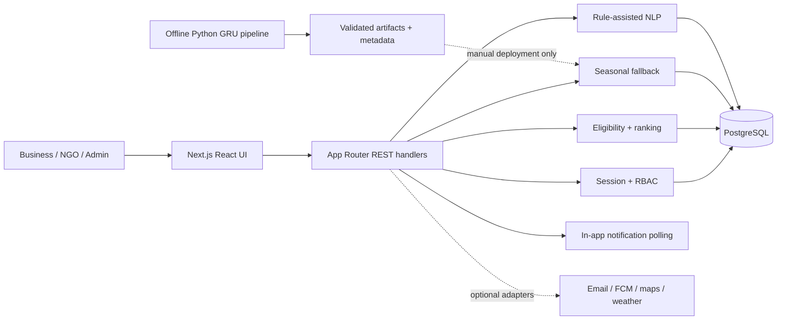
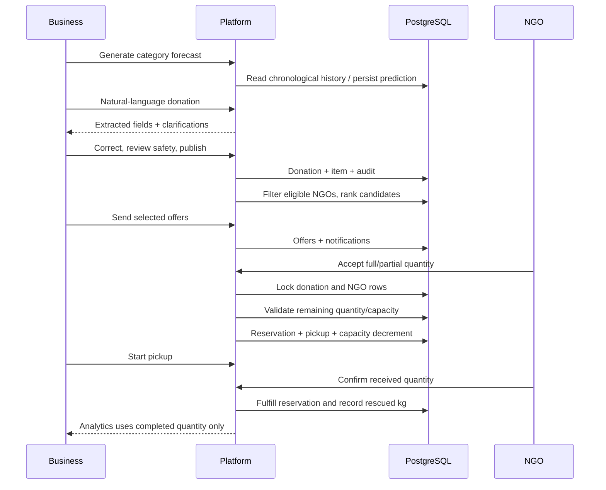
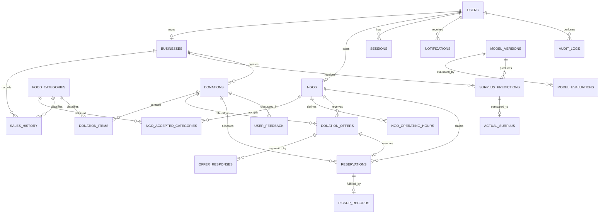
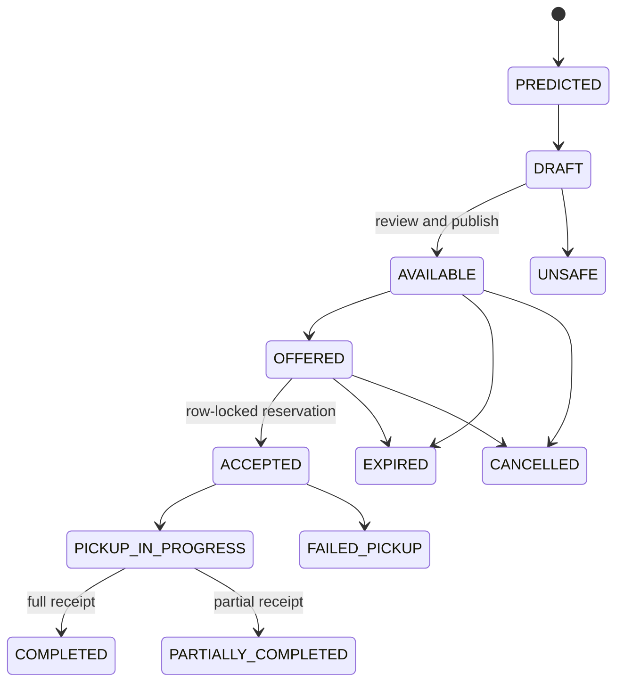

# Architecture

## Runtime components

The application stores all timestamps in UTC. The UI displays India-oriented times (`Asia/Kolkata`). Secrets remain server-side.

## Core donation data flow

## Entity relationship overview

## State machine

## Transaction safety

Acceptance locks both donation and NGO rows (`SELECT … FOR UPDATE`), then validates offer state, expiry, donation deadline, safety review, remaining quantity, and current NGO capacity. A unique reservation per offer and database quantity checks provide a second line of defense. Cancellation releases active capacity in the same transaction.

## Extensibility

- Replace keyword semantic similarity with a versioned Sentence-Transformer adapter without changing hard filters.
- Deploy the validated Python artifact behind a model endpoint; retain fallback behavior for unavailable artifacts.
- Add a routing adapter while continuing to label Haversine distance separately.
- Add image classification only as category/packaging assistance, never as evidence that food is safe.
